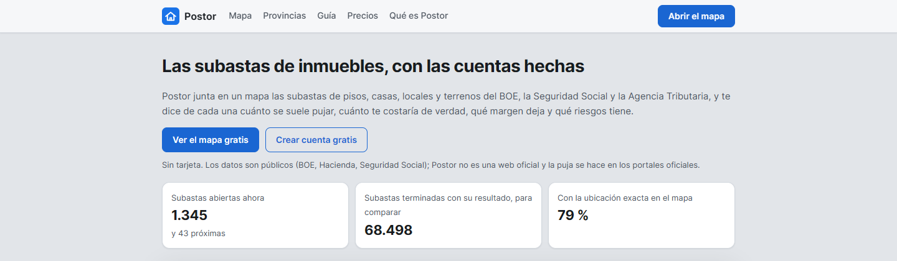
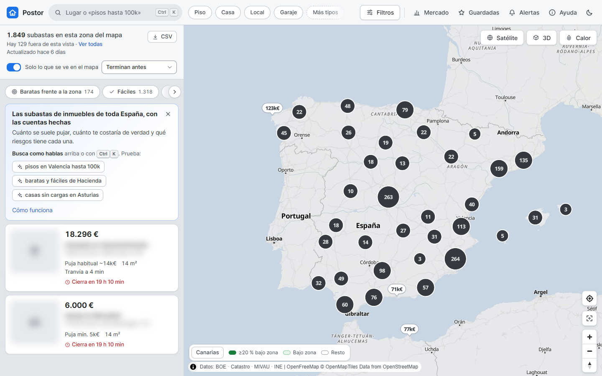
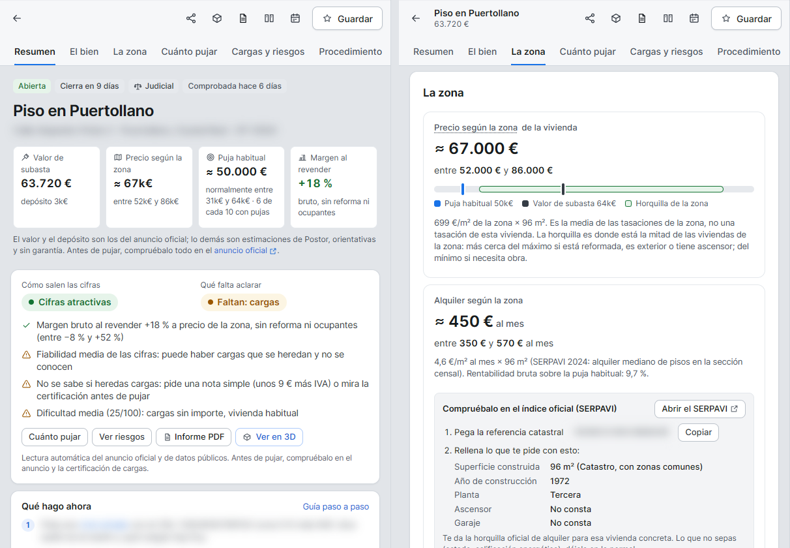
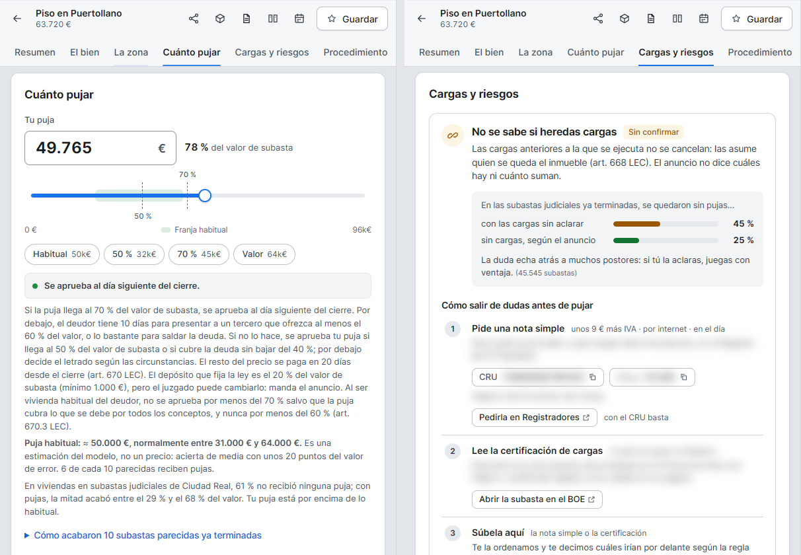
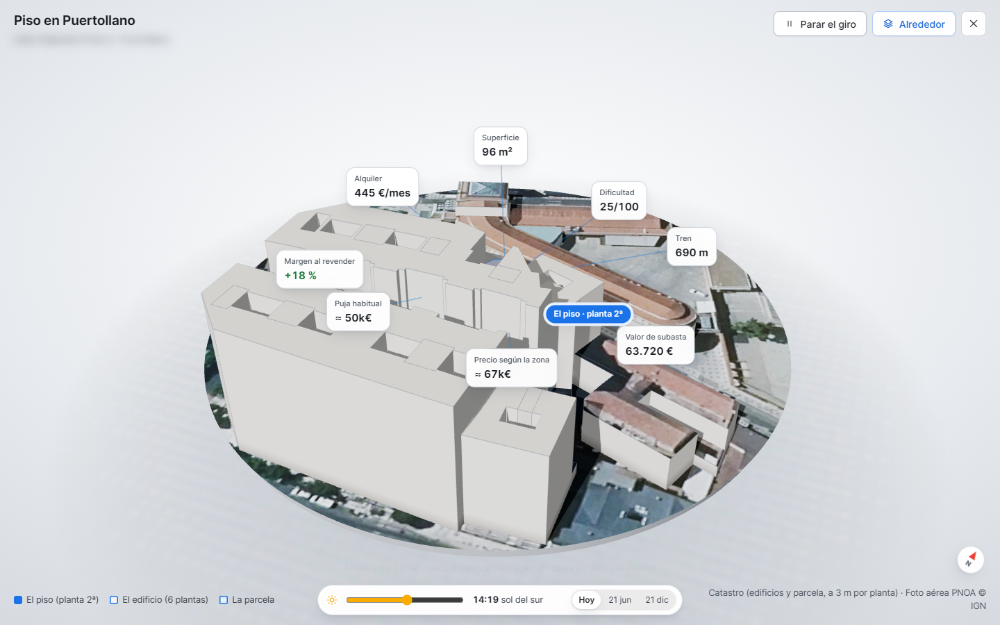
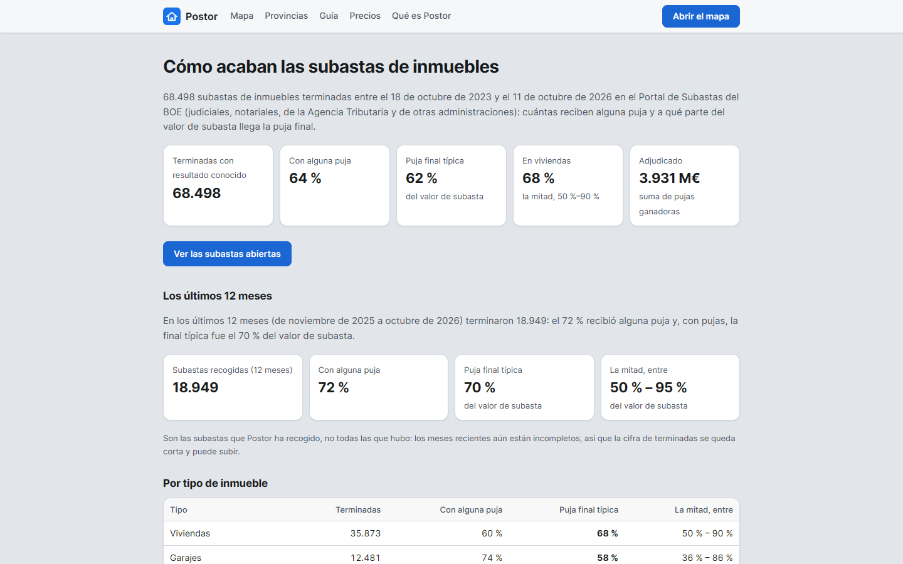
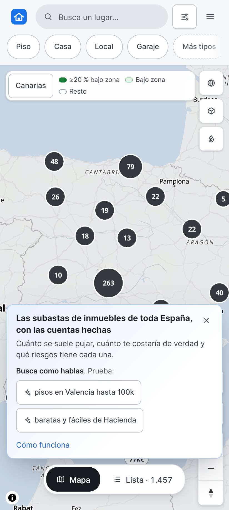
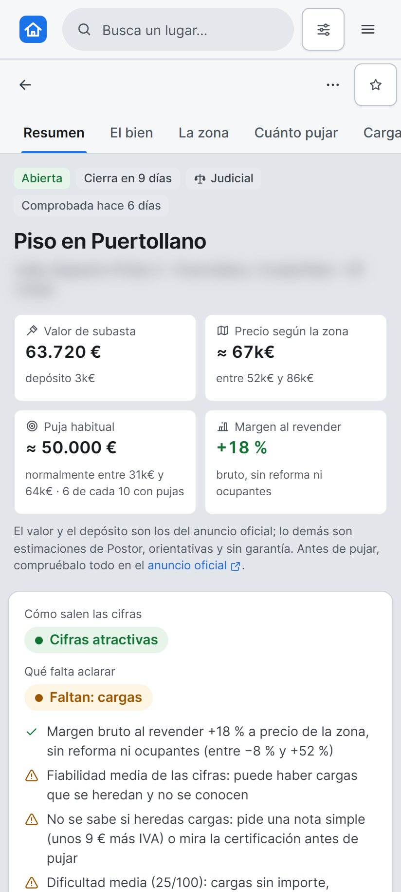

# Postor

Public property auctions in Spain on one map, with the maths already done: what the flat is really worth, what people usually bid, and what can go wrong.

I started this after trying to look at auctions from the BOE, the Social Security and the Tax Agency. They live in different portals, each with its own format, and none of them tells you the one thing you need: is this cheap, and how much do these things actually sell for? So I built the answer. Postor pulls the public data together, puts it on a map, and for every auction shows a price for the area, a likely final bid with a range, the margin if you resell, and the risks buried in the notice.

It's in a private preview and about to open at postor.es.

## What it does

- Collects auctions from the BOE auction portal, the Social Security and the Tax Agency, and crosses them with the Cadastre, the housing ministry's appraised values, rental data, census and income figures, and the nearest stations.
- Shows everything on a map with filters (type, province, "cheap for the area", "no charges", and so on) and plain-language search like "flats in Valencia under 100k".
- Gives every auction a page with the key numbers on top: auction value, price according to the area with a range, the usual bid, and the gross margin. Below that, the area, a bid calculator with taxes, the risks with a citation, and a block about charges (liens) with the steps to check them.
- Has a 3D view of the real site: Cadastre buildings and plot, an aerial photo underneath, and the sun for any day and hour, so you can see if the flat gets light.
- Sends alerts (on the web, in the browser, or as a calendar file) and has public pages for statistics, accuracy, provinces and municipalities, a PDF report per auction, CSV export, an MCP server and an API with keys.
- There's a free plan and paid plans for people who need more reports or the API.

All the screenshots are of real public auctions. I blurred the address, the cadastral reference and the case numbers.

The public statistics page, built from every finished auction I have, and the same app on a phone:

 

## The machine learning model

This is the part I enjoyed most. Two questions decide whether an auction is worth it: will anyone bid at all, and if so, how far above the minimum will it go? The model predicts both.

- A classifier gives the probability that an auction gets any bid.
- Three quantile regressors (25th, 50th and 75th percentile) give the expected final bid as a share of the auction value, and a range around it.

Both are gradient boosting (scikit-learn's histogram version). The inputs are the kind of asset, the procedure, the province, size, auction value, the zone price, the municipality's market (sales, rent, income, population), the closing month and whatever the notice says (occupied, main residence, charges, difficulty). The two models don't use exactly the same inputs: the trend over time helps the bid model but made the classifier rank worse, so I measured it and split them.

It's trained on 66,935 finished auctions with their real outcome. The test is temporal, which is the only honest way here: I train on what ended before 4 February 2026 and measure on the 9,589 later auctions that received bids. The range is scaled on the first half of that test and checked on the second, so it really covers about half of the outcomes. The probability is calibrated too.

What came out, with errors measured in points of the auction value (if I say 60% and it ends at 70%, that's 10 points):

- Typical error of the bid: 19.6 points, against 22.0 for my earlier method based on similar past auctions. For homes with a zone price it's 16.1 against 17.7.
- Ranking which auctions get bids: AUC of 0.76, up from 0.71.
- Range: 52% of outcomes fall inside it, by design.

Live numbers are worse, and I publish them anyway. Since 12 October 2026 I record the bid I would have shown the day before, and on the 122 auctions with bids that have finished since, the typical error is 23.9 points and 44% land inside the range. The probability is also too cautious: I said 65% and the real rate was 77%, so the page tells people to read it as a floor. Auctions from the Tax Agency are the hardest, and storage rooms and rural plots too.

I tried a lot of things that didn't help: one model per procedure, each municipality's history, weighting recent auctions, bigger trees. Changing hyperparameters barely moved the error, which tells me the limit is the data and not the algorithm. One feature I dropped on purpose was the minimum bid, because in the historical data it's downloaded after the auction and leaks the answer. The model is retrained every night as more history comes in.

## Accuracy and privacy

I don't want the app to look more sure than it is. The auction value and the deposit come from the official notice and are labelled that way, and everything else is marked as an estimate, "indicative, no guarantee", with a link to the official notice. It never says "advice". Each figure carries a reliability level, and when it's low the app doesn't show a margin at all. There are daily checks on the open auctions (for example, the deposit matches the expected percentage in 99.4% of them) and the test suite has over 500 tests.

Names of private people are never kept: an anonymiser runs when data is saved and again as a clean-up pass.

## Built with

Python, FastAPI and SQLite on the back end, scikit-learn for the model, and a front end with no build step (Preact, htm, MapLibre) plus three.js for the 3D view.

---

The source code is private. This repo shows what Postor does and how it works; happy to walk through it.

© 2026 Arnau Mas
